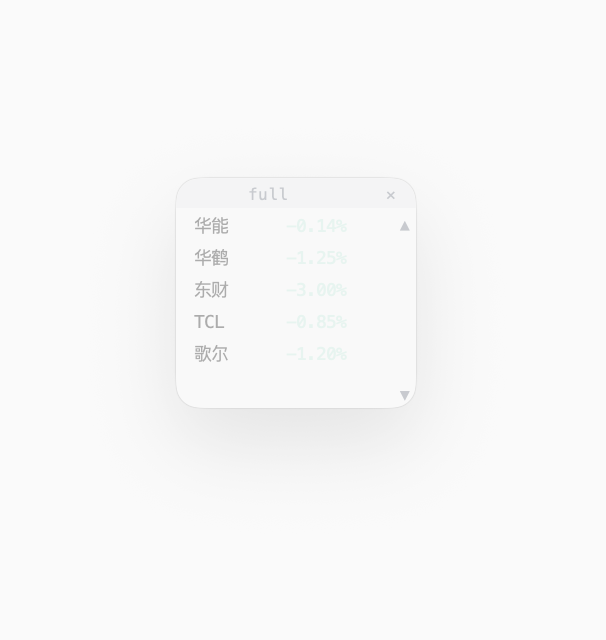
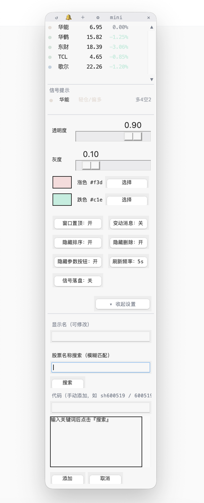

# 股票浮窗 stock-monitor

一个浮动、隐蔽的股票行情 HUD：常驻桌面实时刷新你关注的股票，叠加多空信号打分，异动时弹出系统通知并落盘 CSV。**可打包为 macOS App / Windows exe，双击即用**，也支持纯源码运行。

**纯 Python 标准库 + tkinter，零第三方依赖（仅打包工具需要 PyInstaller/Pillow）。**





> **mini 极简视图**（上图）：点菜单栏 `mini` 按钮后的形态 —— 每行只留 **股票名 + 涨跌幅**，信号提示区 / 状态栏 / 价格 / 信号灯 / 滚动条全部收起，顶部仅剩 `full` 与 `✕`。**窗口内任意空白处按住左键都能拖动**，松手即记住位置。
> **展开视图**（下图）：full 模式 —— 顶部按钮区（左→右）为 **↺ 刷新 → 🔔 显示变动 → ＋ 新增 → ⚙️ 设置 → mini**，最右端是 **✕ 关闭**；行情行 = 信号点 + 名称 + 价格 + 涨跌幅 + 工具按钮（▲ 上移 / ⚙ 参数 / 🗑 删除，可由设置面板一键隐藏），右侧带滚动条；下方为信号提示区（默认只展示有信号变动的股票，300 秒滑动窗口）与状态栏。图中同时展开了 ⚙️ 设置面板（透明度 / 灰度滑杆、窗口置顶 / 变动消息 / 隐藏排序 / 隐藏删除 / 隐藏参数 / 信号落盘开关、刷新频率、涨跌色选择器）与 ＋ 添加面板（股票名模糊搜索 / 代码手动输入 / 结果列表）。**鼠标移出浮窗自动降到 0.35 透明淡出，移回恢复**；**点击行情行（非工具按钮）即复制股票代码到剪贴板**。

### mini 极简模式

点顶部 **`mini`** 按钮即可把浮窗收成「一列涨跌幅」——盯盘时只占桌面很小一块，按钮文案变为 **`full`**，再点一次还原：

| 元素 | full | mini |
|------|------|------|
| 行情行内容 | 信号点 + 名称 + 价格 + 涨跌幅 + 工具按钮 | **名称 + 涨跌幅** |
| 信号提示区 / 状态栏 | 显示 | 隐藏 |
| 滚动条 | 显示 | 隐藏（顶部/底部 ▲▼ 翻行入口保留） |
| 顶部按钮 | 全部 | 仅 `full` 与 `✕`（菜单栏空白仍可拖动窗口） |

- **模式会被记住**：切换时写入 `config.toml` 的 `mini_mode`，下次启动直接进入该模式；外部编辑该键 2 秒内热重载生效
- 两种模式下 `✕` 关闭按钮都在菜单栏最右端

---

## 一、三种使用方式（任选）

### 方式 A：macOS App（推荐，双击即用）

在 macOS 上构建独立 `.app`（捆绑 Python 运行时，目标机器无需安装任何环境）：

```bash
cd app_build
./build_app.sh          # 产物: ../发布/股票浮窗.app
```

- 首次运行会在 **`.app` 同级目录**自动生成 `config.toml` / `stocks.toml`（内置模板复制，用文本编辑器修改后 **2 秒热重载生效**）
- 信号 CSV（`signals_YYYY-MM-DD.csv`）也落在 `.app` 同级
- 若首次双击被 Gatekeeper 拦截：右键 → 打开 → 确认即可

### 方式 B：Windows exe

在 Windows 机器上双击 **`app_build/build_windows.bat`**，自动完成：找 Python 3.11+ → 生成图标 → 装 PyInstaller → 打包单文件 `股票浮窗.exe` → 输出到 `..\发布\`。

- 双击 exe 即运行；配置 / 信号 CSV 同样落在 exe 同级，热重载生效
- 前置要求：安装 [python.org](https://www.python.org/downloads/) 官方 Python 3.11+（勾选 *Add python.exe to PATH*）

> PyInstaller 不支持跨平台打包：Windows exe 必须在 Windows 上构建（`app_build` 目录已同时备好 macOS / Windows 两套构建脚本与图标）。

### 打包版数据保存在哪（重要）

macOS App / Windows exe 的所有运行数据都落在**程序同级目录**（即 `股票浮窗.app` / `股票浮窗.exe` 所在目录），不是 App 内部、也不是固定路径：

| 数据 | 位置 | 产生时机 |
|------|------|----------|
| 股票列表 `stocks.toml` | 程序同级 | 首次运行自动生成；＋新增 / 🗑删除 / ▲排序 即时回写 |
| 设置 `config.toml` | 程序同级 | 首次运行自动生成；设置面板改动、mini/full 模式切换、窗口拖动位置均即时写盘 |
| 信号 CSV `signals_YYYY-MM-DD.csv` | 程序同级 | 按天滚动；设置面板「信号落盘」开关或 `--no-log` 可关闭 |

- ✅ **重新打包 / 重新构建不会覆盖这些文件**：构建只重建 `.app` / `.exe` 本体；首次运行也仅在文件不存在时才从内置模板生成
- ⚠️ **路径跟随程序位置**：若把 `.app` / `.exe` 移到新目录，会在新位置重新生成一套配置。**备份 / 迁移 = 拷贝程序同级的 `config.toml` + `stocks.toml` + `signals_*.csv`**
- 程序内部的内置同名文件只是"首次生成模板"，运行后不再读取

### 方式 C：纯源码运行（无需打包）

```bash
# 需要 Python 3.11+（自带 tkinter）
python3 stock_float.py

# macOS 也可直接双击 启动浮窗.command；Windows 双击 启动浮窗.bat（自动找 Python）
```

---

## 二、功能特性

- **实时行情浮窗**：常驻桌面，半透明、无边框（macOS 下无标题栏与红绿灯）、可拖动。A 股实时行情；港股 / 美股免费源约 15 分钟延时（自动标注"延时"并显示数据时间）。
- **多空信号打分引擎**：基于 MA / RSI / MACD 等指标的加权打分，输出五档信号（买入 / 偏多 / 持有 / 偏空 / 卖出），用颜色圆点直观标识。可扩展 KDJ / BOLL / VOLUME 指标。
- **支撑 / 压力位穿越检测**：为每个股票配置支撑 / 压力价位，价格上穿或下穿时触发系统通知并落盘 CSV（带冷却，避免横跳刷屏）。
- **系统通知（跨平台）**：mac 用 AppleScript、Linux 用 `notify-send`、Windows 用蜂鸣 + 浮窗闪烁。信号变动 / 阈值破位 / 支撑压力穿越时自动提醒。
- **mini 极简模式**：一键收成「只显示股票名 + 涨跌幅」的小窗，模式持久化（`mini_mode`），重启保持。
- **关闭按钮 ✕**：菜单栏最右端，full / mini 两种模式都在，点击静默退出。
- **窗口位置记忆**：拖动浮窗后自动记住坐标（`win_x` / `win_y`），下次启动回到原处；首次启动默认落在屏幕右侧、垂直 3/4 处；换分辨率或拔掉显示器导致坐标越界时自动回退默认。
- **空白处可拖动**：除按钮、输入框、行情行等有自身交互的控件外，窗口内任意空白处按住左键都能移动窗口。
- **手动排序**：每行右侧 ▲ 按钮上移调整顺序，自动持久化到 `stocks.toml`，重启后保持。
- **信号变动聚焦**：信号提示区只展示有信号变动的股票。
- **刷新频率切换**：设置面板内按钮在 1 / 3 / 5 / 10 秒间循环（默认 5s）。
- **外观高度可定制**：暗色模式（light / dark / auto 跟随系统）、字号、透明度、涨跌幅配色（**设置面板选色即时生效，无需重启**）、信号档位配色、灰度去饱和。
- **配置改动一律落盘**：设置面板所有开关 / 滑块改动即时写入 `config.toml`（无总开关，默认持久化）。
- **信号落盘开关**：设置面板「信号落盘」可运行时关闭 / 开启 CSV 写入（独立于配置落盘，即时生效）。
- **体验增强**：鼠标移出淡出 / 移回恢复、点行情行复制代码、异动闪动高亮、配置热重载（2s 轮询 mtime，外部编辑自动生效）。
- **命令行回看与统计**：`--review` 回看历史信号、`--stats` 当日聚合统计、`--no-log` 不写盘。

---

## 三、配置

配置文件放在程序（脚本 / .app / exe）同级，共两个（首次运行自动生成；也可从 `*.example` 复制）：

- **`config.toml`**：浮窗外观、通知、落盘存储、运行参数（行情源 / 刷新频率）、显示模式与窗口位置。
- **`stocks.toml`**：监控策略（指标打分 / 盘中灵敏）+ 变动阈值 / 冷却，以及股票列表 `[[stocks]]`（含个股 `support` / `resistance`）。

> **归属约定**：`stocks.toml` 的 `[settings]` 放监控策略 + 变动阈值 / 冷却；`config.toml` 的 `[settings]` 放外观 / 通知 / 落盘 + 运行参数。同一键两处都有时，`stocks.toml` 优先。

### `config.toml` 主要键

| 键 | 默认 | 说明 |
|----|------|------|
| `csv_mode` | `"daily"` | `daily` 按天滚动到 `signals_YYYY-MM-DD.csv` |
| `csv_dedup_sec` | `60` | CSV 去重窗口（秒），0 = 关闭 |
| `csv_log` | `true` | 信号落盘开关：`false` 时不再写 signals*.csv（设置面板可切换，运行中即时生效） |
| `notify` | `false` | 跨平台系统通知开关 |
| `notify_sound` | `false` | 通知声音 |
| `sources` | `["tencent","sina","eastmoney"]` | 行情源兜底顺序；设 `["tencent"]` 关备用源 |
| `refresh_sec` | `5` | 刷新周期（秒） |
| `mini_mode` | `false` | `true` = 启动即进入 mini 极简模式；点菜单栏 `mini` / `full` 切换时自动写回 |
| `topmost` | `true` | 窗口是否始终置顶 |
| `win_x` / `win_y` | 自动记录 | 窗口左上角坐标：拖动浮窗松手时自动写入，下次启动回到该位置；删除这两行即恢复默认（屏幕右侧 + 垂直 3/4 处） |
| `float_theme` | `"light"` | light / dark / auto（跟随系统） |
| `float_font` / `float_font_size` | `"Menlo"` / `7` | 字体族 / 字号 |
| `float_up_color` / `float_down_color` | 内置默认 | 涨 / 跌色（#RRGGBB） |
| `sig_buy` … `sig_sell` | 内置默认 | 五档信号色 |
| `float_alpha` | `0.94` | 浮窗透明度（0~1） |
| `grayness` | `0.0` | 界面强调色去饱和程度（0 原色 → 1 纯灰阶） |

### `stocks.toml` 主要键

| 键 | 默认 | 说明 |
|----|------|------|
| `indicators` | `["MA","RSI","MACD"]` | 参与打分的指标；可加 `KDJ` / `BOLL` / `VOLUME` |
| `live_indicators` | `true` | 盘中把实时价并入指标序列 |
| `chg_alert` / `swing_alert` | `0` | 变动 / 波动提示阈值（%） |
| `alert_cooldown` | `15` | 阈值 / 支撑压力穿越冷却（分钟） |

### 个股支撑 / 压力

```toml
[[stocks]]
code = "hk01810"
name = "小米集团-W"
support = [18.0, 17.5]        # 价格下穿任一时弹通知 + 写 CSV
resistance = [20.5, 21.0]     # 价格上穿任一时弹通知 + 写 CSV
```

穿越判定用"前价 vs 现价"对比价位，并复用 `alert_cooldown` 冷却。需 `notify=true` 才弹通知；CSV 落盘独立生效。

---

## 四、多市场

- **A 股**（`sh` / `sz`）：实时行情。
- **港股**（`hk`）/ **美股**（`us`）：免费源约 15 分钟延时，浮窗标"延时"并显示接口数据时间。

---

## 五、命令行回看与统计

```bash
python3 stock_float.py --review                  # 回看历史信号(最近30条)
python3 stock_float.py --stats                   # 当日信号聚合统计
python3 stock_float.py --review --code hk01810 --date 2026-07-15
python3 stock_float.py --stats  --code hk01810
python3 stock_float.py --no-log                  # 不写 CSV(或设置面板「信号落盘」开关, 运行中即时生效)
```

---

## 六、开发与测试

核心指标与逻辑以纯函数实现（`sma` / `rsi` / `macd` / `kdj` / `bollinger`），可无头测试：

```bash
python3 -m unittest test_stock_float
```

---

## 七、项目结构

```
.
├── stock_float.py           # 主程序（单文件, 纯标准库）
├── test_stock_float.py      # 单元测试
├── config.toml.example      # 配置模板（复制为 config.toml 使用）
├── stocks.toml.example      # 自选股/监控策略模板
├── 启动浮窗.command         # macOS 源码运行启动器
├── 启动浮窗.bat             # Windows 源码运行启动器
├── docs/                    # 截图与设计文档
└── app_build/               # 打包工具（macOS .app / Windows exe）
    ├── boot.py              # 跨平台引导入口（配置/CSV 重定向到程序同级）
    ├── build_app.sh         # macOS 一键打包
    ├── build_windows.bat    # Windows 一键打包（在 Windows 上运行）
    ├── make_icon.py         # 图标生成（icns / ico）
    ├── 股票浮窗.icns / .ico / icon_1024.png
    └── config.toml / stocks.toml   # 本地打包模板（已 gitignore, 不提交）
```

---

## 八、已知限制

- **备用源字段映射需实测**：新浪（需 `Referer`）与东财（`secid` 编码）按常见口径实现，未逐源联调；任一备用源不可达时主源（腾讯）仍正常，如不可用可在 `sources` 中删去对应项。
- **腾讯实时 `volume` 字段**：先按 `p[6]` 实测；若结构不符会回退 `volume=None` 且不报错。
- **KDJ 简化口径**：用收盘价版 RSV（非严格 high/low 版）。
- **VOLUME 历史量**：默认关；启用时额外拉一次日 K 量（多一次请求 / 股）。
- **打包产物 GUI 交互需真机验证**：鼠标淡出 / hover 恢复、跨平台通知、异动闪动强度、mini 模式布局与空白处拖拽手感等，建议在打包环境中实机确认（源码逻辑已含各平台分支）。
- **Windows 闪烁**：无边框窗口采用 alpha 取反闪烁约 1s 兜底（不做 ctypes Toast）。
- **macOS 无按钮窗口**：依赖 `overrideredirect` + Tk 的 `MacWindowStyle plain/none`（已在 Tk 9.0 上验证可用）；若窗口偶尔重新出现标题栏/红绿灯，程序会在刷新周期内自动纠正。
